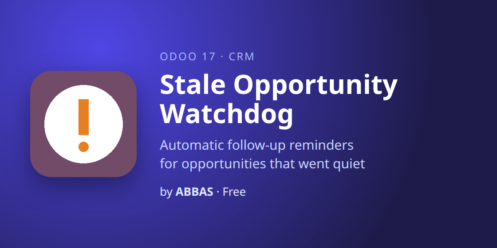

# Stale Opportunity Watchdog — Odoo 18 CRM (v2)

Find the deals that went quiet, before they are lost. Every day the Watchdog checks open
opportunities for **real activity** (a note, an email, a completed activity or a stage change).
When a deal has had none for too long, it is flagged in the pipeline and its salesperson gets a
follow-up reminder. If nobody acts, the sales team leader hears about it.

## Features
- Real activity, not "last modified": automatic updates never hide a quiet deal
- A limit per stage (e.g. 7 days in Proposition, 30 in New), with a company default
- "Stale · 12d" badge on pipeline cards, a Days Inactive column and a banner on the form
- Clears itself the moment someone logs a note, sends an email, completes an activity or moves the stage
- Pause the reminders on a deal until a date, with the reason in the chatter (also for several deals at once)
- Escalation: when the reminder stays overdue, the team leader gets an activity too
- No salesperson? The team leader gets the reminder
- Ignore opportunities with chosen tags
- "Stale Opportunities" report: revenue at risk per salesperson and stage
- Settings per company; depends only on `crm` and `mail`; 15 automated tests

## Install
Copy `crm_stale_watchdog` into your addons path, update the Apps list, and install
**Stale Opportunity Watchdog**. Settings: CRM › Configuration › Settings › Stale Opportunity Watchdog.

The Odoo 17 version is on the [`17.0` branch](../../tree/17.0).

## Versions: Odoo 17, 18, 19 and 20

| Odoo | Price | Get it |
|---|---|---|
| 17 (v1) | Free (LGPL-3) | [Odoo Apps Store](https://apps.odoo.com/apps/modules/17.0/crm_stale_watchdog) |
| 18 (v2) | Free (LGPL-3) | [Odoo Apps Store](https://apps.odoo.com/apps/modules/18.0/crm_stale_watchdog) |
| 19 (v3) | $19 (one-time, OPL-1) | [Odoo Apps Store](https://apps.odoo.com/apps/modules/19.0/crm_stale_watchdog) |
| 20 | Coming soon | In development |

## Author
**ABBAS** — custom Odoo development (Odoo 17, 18, 19 & 20). Support: abbasodolution@gmail.com

License: LGPL-3
